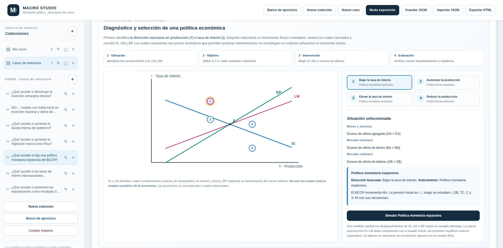
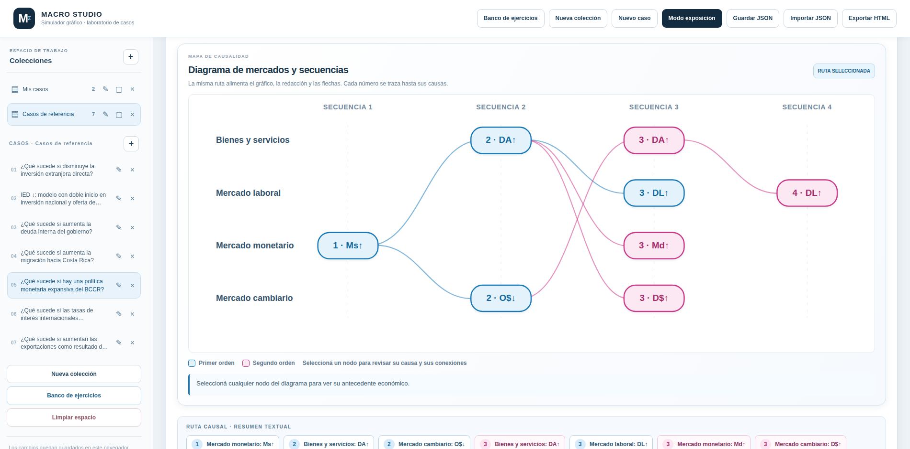
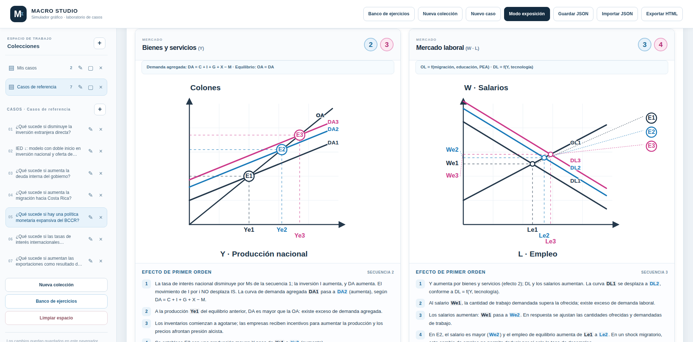
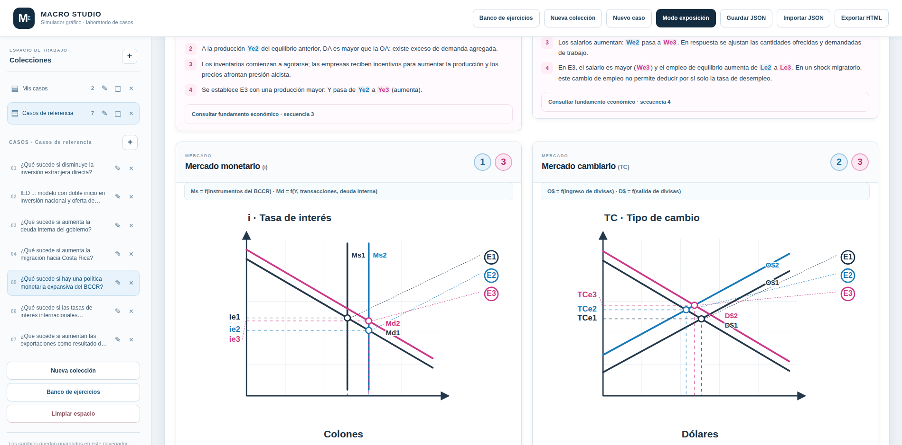
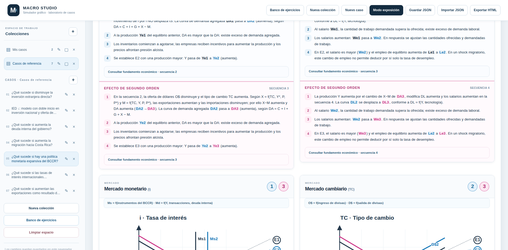
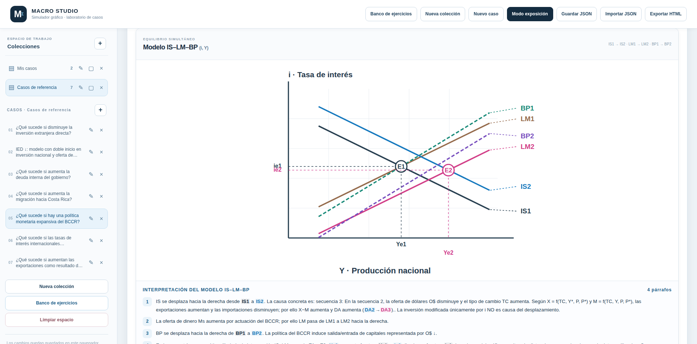
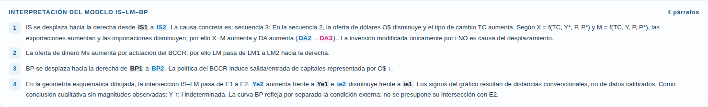

# MACRO STUDIO

### De una decisión económica a sus efectos, mercado por mercado.

**Simulador interactivo de macroeconomía en español:** cuatro mercados, secuencias de primer y segundo orden, mapa causal y modelo IS–LM–BP.

  
  
  
  
  

### [Abrir aplicación](https://juaniflls.github.io/macro-studio/) · [Notebook generador](./Macro_Studio_5_3_Notebook_Generador.ipynb) · [Metodología](./docs/METODOLOGIA.md) · [Validación](./docs/VALIDACION.md)

Autor: <strong>Juan Ignacio Garbanzo Fallas</strong> · Proyecto académico en Economía, Universidad Fidélitas.

---

## El laboratorio

Macro Studio transforma una variable económica y su dirección de cambio en **gráficas, consecuencias explicadas y una ruta causal navegable**. El objetivo es estudiar cómo se transmite un cambio entre los mercados, no solamente observar cuatro gráficos aislados.

### Funcionalidades

- **Cuatro mercados:** bienes y servicios (OA/DA), laboral (OL/DL), monetario (Ms/Md) y cambiario (O$/D$).
- **Secuencias explicables:** efectos de primer y segundo orden, equilibrios E1/E2/E3, antecedentes y flechas interactivas.
- **Predominio económico configurable:** selección de un canal cuando llegan efectos contrapuestos de secuencias anteriores; sin crear vínculos artificiales entre efectos simultáneos.
- **Diagnóstico de política económica:** identificación del desequilibrio, objetivo, instrumento fiscal o monetario y evaluación del resultado.
- **Interpretación IS–LM–BP:** desplazamientos de curvas, producción, tasa de interés y condición cambiaria.
- **Formulario económico:** componentes de DA y funciones anidadas de consumo, ingreso disponible, inversión, gasto público y sector externo, además de los mercados restantes.
- **Espacio de trabajo editable:** colecciones, casos, importación y exportación JSON, exposición y exportación HTML.

## Galería actualizada

Las imágenes se producen **automáticamente desde la aplicación** para mantener el README sincronizado con el notebook. El azul identifica los efectos de primer orden y el rosado los de segundo orden.

### Diagnóstico y política económica

El diagnóstico permite analizar cuatro situaciones ilustrativas sin vincularlas a grupos o ejercicios de una fecha específica. Seleccionar una intervención no garantiza por sí solo el equilibrio simultáneo de los mercados.

### Diagrama causal y secuencias

Las conexiones representan antecedentes económicos. Dos efectos con el mismo número pueden ser simultáneos: no deben interpretarse como si uno necesariamente generara al otro.

### Gráficas de los cuatro mercados

<table>
<tr>
<td width="50%" valign="top"> <strong>Bienes y servicios · Laboral</strong> Producción, empleo y salarios.</td>
<td width="50%" valign="top"> <strong>Monetario · Cambiario</strong> Interés, dinero, divisas y tipo de cambio.</td>
</tr>
</table>

### Explicaciones y fundamentos económicos

Cada efecto distingue desplazamiento, desequilibrio, ajuste y nuevo equilibrio. Las fórmulas se consultan de manera desplegable para no interrumpir la explicación.

### Modelo conjunto IS–LM–BP

<table>
<tr>
<td width="58%" valign="top"></td>
<td width="42%" valign="top"></td>
</tr>
</table>

La interpretación distingue el **resultado dibujado** y las conclusiones **sin magnitudes calibradas**. Si IS y LM se desplazan simultáneamente, la variación final de la tasa de interés puede requerir información adicional. BP se analiza como condición externa, no como un equilibrio automáticamente garantizado.

## Marco económico

La identidad de demanda agregada es:

**Y = C + I + G + X − M**

El equilibrio del mercado de bienes y servicios se expresa como **OA = DA**; fuera del equilibrio pueden existir excesos de oferta o demanda.

El consumo se descompone en **C = C₀ + PmgC × Yd**, y el ingreso disponible se relaciona con salarios, impuestos, transferencias y otros determinantes considerados en las presentaciones. El formulario también muestra los componentes y condicionantes de inversión, gasto público, exportaciones e importaciones.

| Intervención | Mercado inicial | Mecanismo |
|---|---|---|
| Política fiscal: modificar G | Bienes y servicios | G modifica directamente DA |
| Política monetaria: modificar Ms | Monetario | Instrumentos del BCCR modifican Ms y presionan i |

Un cambio de i por sí solo no desplaza IS: la variación inducida de I representa un movimiento a lo largo de esa curva. LM cambia por Ms, no simplemente por los movimientos de Md.

## Utilizar Macro Studio

**[Abrir en el navegador](https://juaniflls.github.io/macro-studio/)** para seleccionar o crear casos, consultar gráficas y guardar una copia JSON. La aplicación puede ejecutarse también **sin conexión**, descargando el archivo [index.html](./index.html) con la opción de archivo sin procesar de GitHub.

### Generación reproducible

El archivo principal es **[Macro_Studio_5_3_Notebook_Generador.ipynb](./Macro_Studio_5_3_Notebook_Generador.ipynb)**. Incluye reglas, referencias, estilos e interfaz. Su ejecución completa produce exactamente **index.html**, el archivo usado por GitHub Pages.

**Fuente única de desarrollo:** `Macro_Studio_5_3_Notebook_Generador.ipynb`. Es el único notebook activo del repositorio. Las revisiones históricas pueden recuperarse desde el historial de Git; no son archivos de trabajo de la rama principal.

~~~bash
python -m pip install jupyterlab
jupyter lab
~~~

Al modificar el notebook en la rama principal, GitHub Actions regenera la aplicación, ejecuta las pruebas, actualiza la galería y publica la versión web.

## Estructura

~~~text
macro-studio/
├── Macro_Studio_5_3_Notebook_Generador.ipynb
├── index.html
├── src/
│   ├── engine.js
│   ├── app.js
│   ├── references.js
│   └── styles.css
├── assets/screenshots/actuales/
├── scripts/capturar_vistas.py
├── tests/test_app.py
├── docs/
├── .github/workflows/
│   ├── ci.yml
│   ├── sincronizar-notebook.yml
│   └── pages.yml
├── CITATION.cff
├── LICENSE
└── README.md
~~~

Los módulos de código de la carpeta src son copias inspeccionables del HTML generado, no implementaciones independientes. Se conservan las versiones anteriores para comparación histórica.

## Alcance, autoría y licencia

El proyecto surge del trabajo académico de **Macroeconomía I y II de la Universidad Fidélitas** y sigue la metodología estudiada en sus presentaciones y clases. El diseño, la programación y la integración de Macro Studio corresponden a **Juan Ignacio Garbanzo Fallas**.

Es un **modelo cualitativo docente**, no una estimación econométrica ni una predicción calibrada. Las pruebas automáticas detectan regresiones técnicas; cada interpretación debe seguir siendo coherente con sus supuestos. Consultá la [metodología](./docs/METODOLOGIA.md), la [validación](./docs/VALIDACION.md) y el [registro de cambios](./CHANGELOG.md).

**Licencia:** [MIT](./LICENSE) © 2026 Juan Ignacio Garbanzo Fallas. Los materiales y las marcas de terceros conservan sus derechos respectivos.

---

<strong>Macro Studio</strong> · Una ruta causal para entender la transmisión económica.

