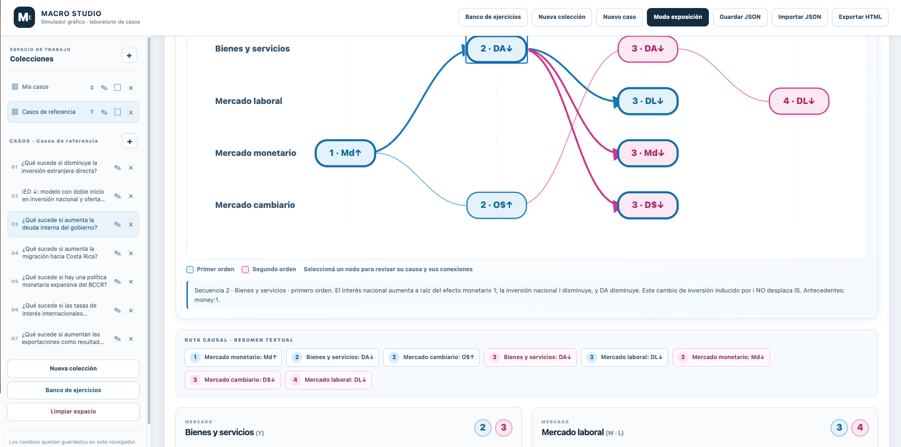
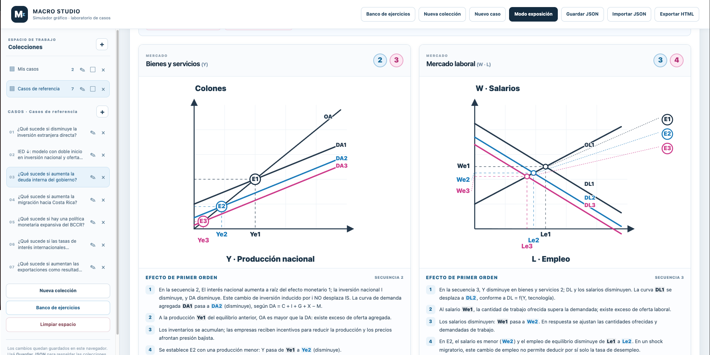
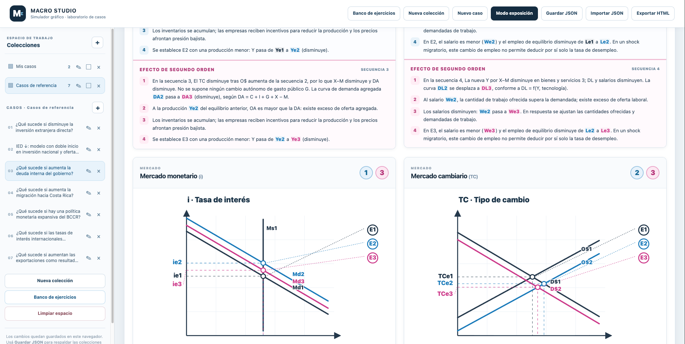
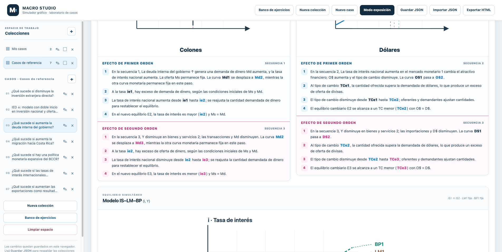
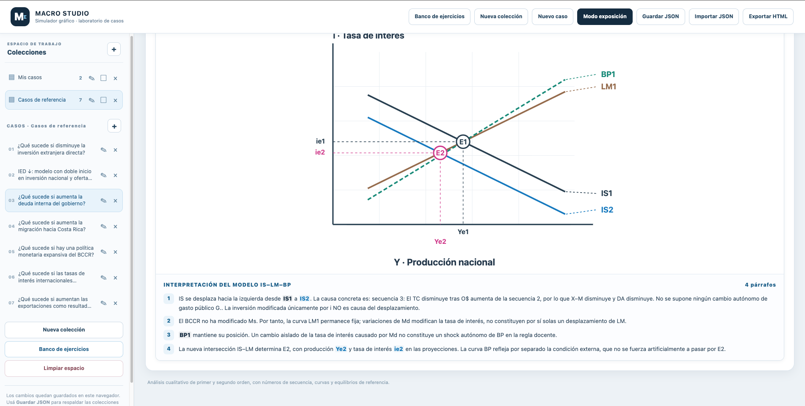
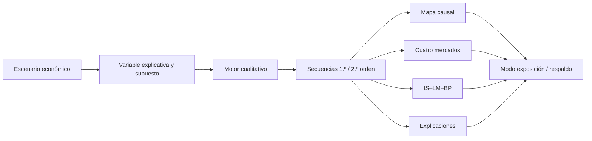

<div align="center">

# MACRO STUDIO

### De un cambio económico a una explicación causal, paso a paso.

**Aplicación interactiva de macroeconomía en español para estudiar la transmisión entre cuatro mercados, los efectos de primer y segundo orden y el modelo IS–LM–BP.**

<p>
  
  
  
  
  
  <a href="./LICENSE"></a>
</p>

**[Abrir Macro Studio en línea](https://juaniflls.github.io/macro-studio/) · [Descargar aplicación HTML](./index.html) · [Ejecutar el notebook](./Macro_Studio_5_1_Notebook_Generador.ipynb) · [Entender el modelo](./docs/METODOLOGIA.md) · [Auditoría y pruebas](./docs/VALIDACION.md)**

<sub>Desarrollado por <strong>Juan Ignacio Garbanzo Fallas</strong> · Proyecto académico de economía convertido en una herramienta reutilizable.</sub>

</div>

---

## Novedades de la revisión 5.1

- **Formulario económico desplegable:** funciones de C, I, G, X, M y relaciones fundamentales de los cuatro mercados, basadas en las presentaciones del curso.
- **Trazabilidad causal:** las flechas conectan una secuencia anterior con una posterior; el retorno cambiario `O$2 → TC → X−M → DA3` no atribuye a DL3/Md3 una causa simultánea.
- **Política fiscal diferenciada de política monetaria:** G se modifica en bienes y servicios; la liquidez del BCCR se modifica mediante Ms.
- **Diagnóstico opcional IS–LM–BP:** identificación ilustrativa de excesos y selección de medidas; no constituye una predicción ni una política que garantice equilibrio general.
- **Notebooks y publicación:** al ejecutar el generador 5.1 se produce `index.html`, el archivo de entrada de GitHub Pages.

## Una pregunta. Cuatro mercados. Una ruta económica explicable.

**Macro Studio**, desarrollado en español, transforma un escenario económico —por ejemplo, *¿qué sucede si disminuye la inversión extranjera directa?*— en una secuencia de relaciones causales, curvas y explicaciones. El usuario determina las hipótesis y puede elegir cuál mecanismo prevalece cuando existen efectos contrapuestos. El software **no estima elasticidades ni sustituye la interpretación económica**.

<p align="center"></p>

## Qué podés hacer

| Capacidad | Qué ofrece |
|:--|:--|
| **Cuatro mercados** | Bienes y servicios, laboral, monetario y cambiario, representados con curvas, equilibrios y variables resultado. |
| **Primer y segundo orden** | Una secuencia causal numerada; el segundo orden se distingue visualmente del primero. |
| **Mapa causal interactivo** | Nodos y flechas que muestran dependencias; permite seleccionar un efecto para explorar sus causas. |
| **IS–LM–BP** | Representación conjunta cualitativa de las curvas y sus desplazamientos bajo las reglas docentes implementadas. |
| **Rutas alternativas** | Permite explorar un inicio cambiario o un doble inicio para el caso IED, según el supuesto adoptado. |
| **Efectos contrapuestos** | Selección explícita de predominio de consumo, inversión o exportaciones netas, cuando el escenario lo requiere. |
| **Narrativa económica** | Explicaciones por secuencia que conectan la variable previa, el signo del efecto y la curva afectada. |
| **Colecciones editables** | Crear, organizar, renombrar, duplicar y eliminar casos y colecciones. Banco de ejercicios para reutilizar escenarios. |
| **Modo exposición** | Vista preparada para presentar las gráficas y la ruta. |
| **Portabilidad** | Funciona como archivo HTML sin servidor, con guardado local y exportación/importación JSON. |

## Así se ve

### 01. De la variable explicativa a la ruta causal

<p align="center"></p>

El mapa muestra **qué mercado inicia**, cuáles reciben el efecto y cómo se produce la retroalimentación. Azul identifica el primer orden y rosado el segundo; las flechas no son independientes de las gráficas, proceden del mismo análisis.

<table>
  <tr>
    <td width="50%"><br/><sub><b>02 · Bienes y servicios + laboral</b><br/>Curvas, equilibrios y numeración.</sub></td>
    <td width="50%"><br/><sub><b>03 · Monetario + cambiario</b><br/>Interés, dinero, divisas y tipo de cambio.</sub></td>
  </tr>
  <tr>
    <td width="50%"><br/><sub><b>04 · Explicaciones trazables</b><br/>Un relato causal debajo de cada gráfica.</sub></td>
    <td width="50%"><br/><sub><b>05 · IS–LM–BP</b><br/>Interpretación de equilibrio conjunto.</sub></td>
  </tr>
</table>

<details>
<summary><b>Ver el banco de ejercicios</b></summary>

<br/>


</details>

## Empezar en menos de un minuto

### Opción A — Usar la aplicación en línea (GitHub Pages)

Accedé a **[Macro Studio — aplicación interactiva](https://juaniflls.github.io/macro-studio/)**. Este enlace abre el simulador en el navegador; a diferencia del archivo dentro del repositorio, permite utilizar sus controles directamente. GitHub Pages requiere activarse una sola vez en **Settings → Pages → Source → GitHub Actions**. Después podés iniciar [el flujo de publicación](https://github.com/juaniflls/macro-studio/actions/workflows/pages.yml). Hasta que se complete ese despliegue, utilizá la opción sin conexión.

### Opción B — Abrir sin conexión

1. Descargá **[`index.html`](./index.html)** (desde GitHub usá **Download raw file**) y abrilo con tu navegador.
2. Elegí un caso o creá uno nuevo.
3. Definí la variable explicativa, su dirección y, cuando corresponda, la ruta o el mecanismo predominante.
4. Explorá el mapa, los cuatro mercados y la interpretación IS–LM–BP.
5. Guardá una copia con **Guardar JSON** para trasladar tus casos a otro navegador o computadora.

> No requiere instalación, cuenta, servidor, conexión a internet ni datos externos para ejecutar la simulación. Las imágenes de este README y las insignias solo se cargan al visualizar GitHub.

### Opción C — Reconstruir desde Jupyter

El notebook es el **generador autocontenido**: contiene las reglas económicas, estilos, referencias y aplicación. Podés revisarlo, modificarlo y generar de nuevo el HTML.

```bash
python -m pip install jupyterlab
jupyter lab
```

Abrí [`Macro_Studio_5_1_Notebook_Generador.ipynb`](./Macro_Studio_5_0_Final_Notebook_Generador.ipynb) y ejecutá todas las celdas. Obtendrás `Macro_Studio_5_0.html` en el directorio de ejecución.

### Publicación web mediante GitHub Pages

El repositorio incluye un flujo de publicación automática en [`.github/workflows/pages.yml`](./.github/workflows/pages.yml), que despliega `index.html` en [**juaniflls.github.io/macro-studio/**](https://juaniflls.github.io/macro-studio/). El archivo `index.html` contiene la misma aplicación autónoma; el enlace al archivo en GitHub muestra el código, mientras que GitHub Pages ejecuta la interfaz.

> Para la primera publicación debés seleccionar **GitHub Actions** en **Settings → Pages → Build and deployment → Source** y luego ejecutar manualmente [**Publicar aplicación en GitHub Pages**](https://github.com/juaniflls/macro-studio/actions/workflows/pages.yml). Este paso de activación es necesario por permisos de GitHub. El enlace HTML descargable permanece disponible para uso sin conexión. El enlace HTML descargable permanece disponible para uso sin conexión.

## Cómo funciona



**Principio central:** las flechas, las explicaciones y las curvas deben contar *la misma historia económica*. Las rutas alternativas representan supuestos distintos, no resultados estadísticos estimados. Ver [metodología y convenciones](./docs/METODOLOGIA.md).

## Estructura del repositorio

```text
macro-studio/
├── index.html                                  # Aplicación autónoma; GitHub Pages
├── Macro_Studio_5_0_Final_Notebook_Generador.ipynb
├── src/                                        # Código extraído del HTML operativo
│   ├── engine.js
│   ├── references.js
│   ├── app.js
│   └── styles.css
├── assets/screenshots/                         # Capturas originales seleccionadas
├── tests/                                      # Regresión económica + UI
│   ├── test_app.py
│   └── resultados_qa_base.json
├── docs/                                       # Metodología, arquitectura y alcance
├── .github/workflows/ci.yml                # Pruebas automatizadas en GitHub Actions
├── .github/workflows/lanzamiento-v5.yml     # Publicación inicial v5.0.0
├── LICENSE                                     # Licencia MIT
├── .gitattributes                              # Estadísticas de lenguajes GitHub Linguist
├── .gitignore
├── CITATION.cff
├── CHANGELOG.md
└── README.md
```

Las fuentes de `src/` son una **copia inspeccionable del HTML que se entrega**, no una segunda implementación. El archivo de producción y el notebook son autónomos; no importan estos módulos de forma externa. Para reconstruir la aplicación se ejecuta el notebook.

## Validación y límites

El material de origen incluye un registro de **255 configuraciones ejecutadas** y **22 verificaciones funcionales**. Estas pruebas comprueban propiedades como la numeración, las relaciones del diagrama, el comportamiento de LM frente a Ms y las exportaciones; **no constituyen una validación empírica de todos los escenarios**. La suite reproducible y sus instrucciones están en [`tests/`](./tests/) y [`docs/VALIDACION.md`](./docs/VALIDACION.md).

Macro Studio trabaja con **direcciones cualitativas**. No calcula magnitudes de crecimiento, inflación o desempleo, y cuando existen fuerzas opuestas debe declararse el supuesto elegido. Las posiciones de las curvas son esquemáticas; su geometría no representa estimaciones calibradas.

## Origen académico y reconocimiento

Proyecto desarrollado por **Juan Ignacio Garbanzo Fallas** a partir de ejercicios de macroeconomía primero resueltos manualmente y posteriormente sistematizados en un entorno interactivo. La metodología de los cuatro mercados y la discusión de rutas alternativas se trabajaron en las clases de **Ronney Zamora Leiva**, Universidad Fidélitas, Costa Rica.

Este es un proyecto independiente de aprendizaje y desarrollo. **No es una publicación oficial ni implica respaldo institucional de la universidad o del docente.** Las marcas y materiales de terceros pertenecen a sus titulares.

## Colaborar y citar

Si encontrás un comportamiento inesperado, describí el shock, el supuesto, la ruta esperada y el resultado obtenido siguiendo [CONTRIBUTING.md](./CONTRIBUTING.md). Si utilizás este trabajo en un proyecto académico, consultá [`CITATION.cff`](./CITATION.cff).

**Licencia:** [MIT](./LICENSE) © 2026 Juan Ignacio Garbanzo Fallas. Se permite usar, estudiar, modificar y redistribuir el software conservando el aviso de copyright y la licencia. Las marcas y contenidos de terceros mantienen sus respectivos derechos.

---

<div align="center">
  <sub><b>Macro Studio</b> · Economía explicable, secuencia por secuencia.<br/>Hecho para pensar con modelos, no para reemplazar el criterio económico.</sub>
</div>
